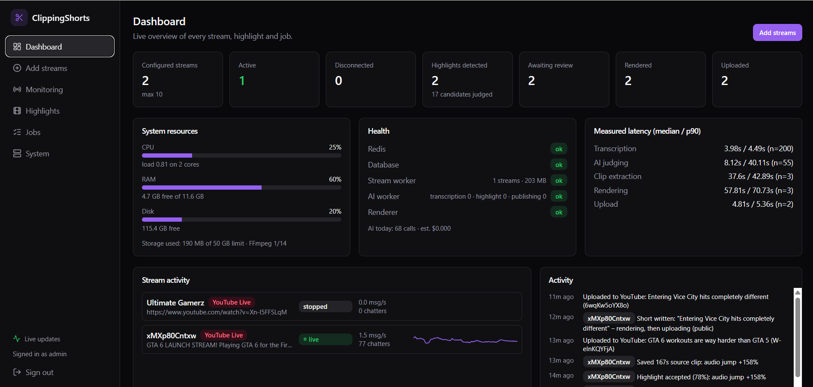
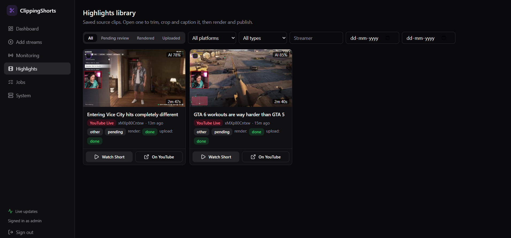
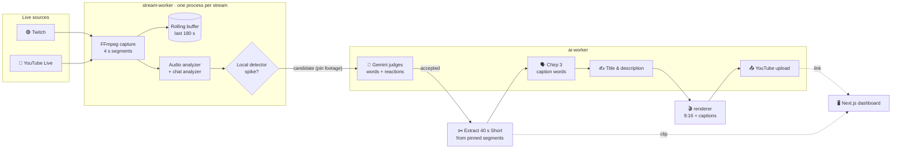

<div align="center">


# ClippingShorts

### Watch up to 10 live streams at once. Catch the best moments automatically. Publish them as YouTube Shorts.

Self-hosted · AI-powered · Twitch & YouTube Live · Built to run on a small server

<br />

[](LICENSE)
[](docker-compose.yml)
[](frontend)
[](backend)
<br />
[](#-google-cloud)
[](#-google-cloud)
[](backend/clippingshorts/clip_renderer.py)
[](#-redis)

<br />

[**Features**](#-features) ·
[**Screenshots**](#-screenshots) ·
[**Quick start**](#-quick-start) ·
[**Setup guide**](#-setup-step-by-step) ·
[**How it works**](#-how-it-works) ·
[**Configuration**](#configuration) ·
[**FAQ**](#-troubleshooting)

</div>

---

## ✨ Features

<table>
<tr>
<td width="50%" valign="top">

### 📡 Multi-stream monitoring
Add **2–10 Twitch or YouTube Live** links. Each stream runs in its own isolated worker; one failing never
affects the others. Start, stop or restart each stream, or all of them at once.

</td>
<td width="50%" valign="top">

### 🧠 Two independent AI judges
Loudness spikes and chat explosions raise candidates for free. **Gemini** then judges them: one judge reads the
words, the other only the reaction numbers. A moment needs real evidence to become a clip.

</td>
</tr>
<tr>
<td valign="top">

### ✂️ 40-second Shorts, automatically
Each highlight becomes a **9:16 Short of 20 s before and 20 s after the moment**. It gets word-by-word captions,
a hook title and loudness normalisation, and is rendered with FFmpeg.

</td>
<td valign="top">

### 🚀 Auto-publish to YouTube
Gemini writes the **title, description and hashtags**, and the Short is uploaded to your channel. You can upload
right away, as private or unlisted, or on a schedule. The YouTube link appears in the dashboard.

</td>
</tr>
<tr>
<td valign="top">

### 🎬 Browser clip editor
Trim on a timeline with thumbnails and a waveform. Drag the crop box, choose **9:16, 16:9 or 1:1**, edit the
captions, title and audio, then export new versions. The source clip is never overwritten.

</td>
<td valign="top">

### 🛡️ Built not to fall over
An admission controller, bounded queues, per-stream memory caps, restart backoff and automatic cleanup keep CPU,
RAM, disk and API spend in check, even on a 2-core VM.

</td>
</tr>
</table>

> [!IMPORTANT]
> **Responsible use.** ClippingShorts keeps only the short windows around highlights, but those clips are still
> other people's content. Only clip and publish streams you own or have permission to use, and follow the terms of
> Twitch, YouTube and the creators you clip. Re-uploading someone else's stream can get your channel copyright
> strikes; the software cannot decide that for you.

---

## 📸 Screenshots

<div align="center">

**Dashboard**: streams, system resources, worker health, pipeline latencies and live activity



<br /><br />

**Highlights library**: review, approve, watch the finished Short or open it on YouTube



</div>

---

## ⚡ Quick start

> You need **Docker** (with Compose v2.17+), a **Google Cloud** service-account key, and optionally YouTube OAuth
> keys. The [step-by-step guide](#-setup-step-by-step) covers all of it for Windows, macOS and Linux.

```bash
git clone https://github.com/<your-account>/clippingshorts.git && cd clippingshorts
cp .env.example .env              # then fill in your passwords and keys
docker network create clippingshorts_redis     # only if you have no Redis yet (see Step 6)
docker compose up -d --build
```

Open **http://localhost:3100** and sign in with your admin password. 🎉

---

## 🧭 Setup, step by step

Everything runs in Docker, so the steps are the same everywhere; only installing Docker differs.

| | Minimum | Comfortable |
|---|---|---|
| **CPU** | 2 cores | 4+ cores |
| **RAM free** | 4 GB | 6–8 GB |
| **Disk free** | 20 GB | 50 GB+ |

### 1️⃣ Install Docker and Git

<details>
<summary><b>🪟 Windows 10 / 11</b></summary>

1. Install **Docker Desktop** from https://www.docker.com/products/docker-desktop/. Keep *Use WSL 2* selected and
   restart when asked.
2. Open Docker Desktop and wait for *Engine running*. Under **Settings → Resources**, give it at least 4 GB of
   memory (6–8 GB is better).
3. Install **Git** from https://git-scm.com/download/win (the defaults are fine).
4. Install **Python 3** from https://www.python.org/downloads/ and tick *Add python.exe to PATH*. It is only needed
   for the one-time YouTube token helper.
5. Use **PowerShell** for the commands below.

</details>

<details>
<summary><b>🍎 macOS (Apple Silicon or Intel)</b></summary>

1. Install **Docker Desktop** from https://www.docker.com/products/docker-desktop/, open it, and wait for *Engine
   running*. Under **Settings → Resources**, give it at least 4 GB of memory.
2. Git and Python 3 come with the developer tools: run `xcode-select --install` if `git --version` fails.

</details>

<details>
<summary><b>🐧 Linux (Ubuntu / Debian; other distributions are similar)</b></summary>

```bash
curl -fsSL https://get.docker.com | sudo sh        # Docker Engine + Compose plugin
sudo usermod -aG docker "$USER"                     # then log out and back in
sudo apt-get install -y git python3
```

</details>

Check everything is installed. Compose must be **v2.17 or newer**:
```bash
docker --version && docker compose version && git --version
```

### 2️⃣ Download ClippingShorts

Use a short folder that stays put: `C:\clippingshorts` on Windows, `~/clippingshorts` on macOS and Linux.

```bash
git clone https://github.com/<your-account>/clippingshorts.git clippingshorts
cd clippingshorts
```

Or, on GitHub, use **Code → Download ZIP**, unzip it into that folder, and open a terminal inside it.

### 3️⃣ Create your settings file

```bash
cp .env.example .env              # macOS / Linux
Copy-Item .env.example .env       # Windows PowerShell
```

Open `.env` in any text editor (on Windows, Notepad saving as UTF-8 is fine) and set the sign-in values:

| Setting | What to put |
|---|---|
| `CLIPPINGSHORTS_SECRET_KEY` | a long random string (see below) |
| `CLIPPINGSHORTS_ADMIN_PASSWORD` | the password you sign in with (8+ characters) |
| `CLIPPINGSHORTS_VIEWER_PASSWORD` | optional read-only password, or leave empty |

<details>
<summary>🔑 How to generate a secret key</summary>

```bash
python3 -c "import secrets; print(secrets.token_urlsafe(48))"                     # macOS / Linux
py -c "import secrets; print(secrets.token_urlsafe(48))"                          # Windows
[Convert]::ToBase64String((1..48 | ForEach-Object { Get-Random -Maximum 256 }))  # Windows, no Python
```

> [!TIP]
> If a password contains `#`, put it in double quotes in `.env`, e.g. `"my#password"`. Otherwise everything after
> the `#` is treated as a comment.

</details>

### 4️⃣ Google Cloud key (Gemini + Chirp 3 speech-to-text)

1. Go to https://console.cloud.google.com, create a project (or pick one) and **attach a billing account**. Gemini
   and Speech-to-Text are paid per use.
2. **APIs & Services → Library**: enable **Vertex AI API** and **Cloud Speech-to-Text API**.
3. **IAM & Admin → Service accounts → Create service account**, with any name. Give it the roles **Vertex AI User**
   and **Cloud Speech Client**.
4. Open the service account, go to **Keys → Add key → Create new key → JSON**. A `.json` file downloads.
5. Move it **outside** the project folder, e.g. `C:\clippingshorts-keys\google.json` or
   `~/clippingshorts-keys/google.json`. Never commit it.
6. In `.env`:
   ```ini
   GOOGLE_SERVICE_ACCOUNT_FILE=/home/you/clippingshorts-keys/google.json   # macOS / Linux
   GOOGLE_SERVICE_ACCOUNT_FILE=C:/clippingshorts-keys/google.json          # Windows: use forward slashes
   GOOGLE_CLOUD_PROJECT=your-project-id
   GEMINI_MODEL=gemini-3.8-flash
   GEMINI_LOCATION=global
   SPEECH_LOCATION=us            # Chirp 3 runs in "us" or "eu"
   SPEECH_LANGUAGE=en-US
   ```

> [!NOTE]
> Model names and regions change over time. Check that your project can use `GEMINI_MODEL` in `GEMINI_LOCATION`;
> ClippingShorts never switches to another model on its own. Want to try without Google first? Set `AI_MODE=local`
> and `TRANSCRIPTION_PROVIDER=none`, and highlights are picked from audio and chat signals alone.

### 5️⃣ YouTube keys (publishing + live chat)

<details open>
<summary><b>Get a YouTube refresh token for your channel</b> (skip if you only want to clip and download)</summary>

1. In the Google Cloud console: **APIs & Services → Library → YouTube Data API v3 → Enable**.
2. **APIs & Services → OAuth consent screen**: choose *External*, fill in the app name and your email, and add your
   Google account under **Test users**.
3. **APIs & Services → Credentials → Create credentials → OAuth client ID → Desktop app**. Copy the **Client ID**
   and **Client secret**.
4. On your computer, inside the project folder, run the one-time helper. A browser opens: sign in with the account
   that owns the channel and allow access.
   ```bash
   python3 scripts/get_youtube_token.py "<CLIENT_ID>" "<CLIENT_SECRET>"     # macOS / Linux
   py scripts\get_youtube_token.py "<CLIENT_ID>" "<CLIENT_SECRET>"          # Windows
   ```
   Paste the four lines it prints (`YOUTUBE_CLIENT_ID`, `YOUTUBE_CLIENT_SECRET`, `YOUTUBE_REFRESH_TOKEN`,
   `YOUTUBE_CHANNEL_ID`) into `.env`.
5. Verify it:
   ```bash
   python3 scripts/check_youtube_token.py        # Windows: py scripts\check_youtube_token.py
   ```
   You should see the scopes `youtube.upload` and `youtube.readonly` and your channel name.

</details>

> [!WARNING]
> - While the OAuth app is in *Testing*, Google **expires refresh tokens after about 7 days**. Set it to *In
>   production* for a token that lasts.
> - The YouTube Data API has a daily quota (10,000 units by default), and uploads use a lot of it.
> - Keep `AUTO_UPLOAD=off` (the default) until you trust the results. Clips then wait for your review in the
>   library.

### 6️⃣ Redis

Most people on Windows and macOS have no Redis yet. Use the bundled one:
```bash
docker network create clippingshorts_redis
```
```ini
# in .env
COMPOSE_PROFILES=bundled-redis
REDIS_NETWORK=clippingshorts_redis
REDIS_URL=redis://redis:6379/4
```
Already running Redis in Docker? See [Redis](#-redis) to use it instead.

### 7️⃣ Start it

```bash
docker compose up -d --build     # first build: 5–15 minutes
docker compose ps                # all services should become "healthy"
```

Open **http://localhost:3100**, sign in, and you're in. Change the port with `CLIPPINGSHORTS_FRONTEND_PORT`.

### 8️⃣ Try it safely first (synthetic streams)

Set `CLIPPINGSHORTS_ENABLE_SYNTHETIC=1` in `.env` and run `docker compose up -d`. Then, in **Add streams**, pick
**Synthetic (test)** with a link like `synthetic://test1?bursts=60&chat=3`. It plays a test video like a live
stream, with a loud moment and a chat explosion every minute. Once that works, add your real Twitch or YouTube Live
links.

<details>
<summary><b>🌍 Running it on a server (remote access, HTTPS)</b></summary>

**From your computer, with nothing exposed:** open an SSH tunnel, then browse to http://localhost:3100.
```bash
ssh -L 3100:127.0.0.1:3100 you@your-server
```

**On the internet:** put it behind HTTPS and set `CLIPPINGSHORTS_COOKIE_SECURE=1` and
`CLIPPINGSHORTS_FRONTEND_BIND=127.0.0.1`. For nginx, turn buffering off so live updates and video previews stream:
```nginx
location / {
    proxy_pass http://127.0.0.1:3100;
    proxy_http_version 1.1;
    proxy_set_header Host $host;
    proxy_set_header X-Forwarded-For $remote_addr;
    proxy_buffering off;
    proxy_read_timeout 3600s;
}
```
On cloud VMs, also open the dashboard port in the provider's firewall or security list. Only that port is ever
needed: the API, Redis and the workers stay internal.

</details>

<details>
<summary><b>🧰 Everyday commands</b></summary>

```bash
docker compose ps                          # status
docker compose logs -f ai-worker           # follow a log (backend, stream-worker, ai-worker, renderer, frontend)
docker compose restart stream-worker       # restart one service; running streams resume by themselves
docker compose up -d                       # apply .env changes (no rebuild needed)
docker compose down                        # stop; clips and settings stay in the "clippingshorts_data" volume
git pull && docker compose up -d --build   # update
```

> [!CAUTION]
> `docker compose down -v` also **deletes every saved clip**. Use it only to start from scratch.

</details>

---

## 🔍 How it works



<details>
<summary><b>How a highlight is decided</b></summary>

1. **Local detector** (free, every second). It compares loudness with this streamer's own rolling baseline, so a
   naturally loud streamer isn't "always exciting". It counts **different people** chatting per second against
   their baseline. Emotes, repeats and reaction words add weight, and single-user spam is discounted. Cooldowns
   and an hourly cap apply.
2. **Pin.** The candidate pins its buffer range, so the footage can't expire while it's judged. Overlapping
   candidates merge into one window.
3. **Judges.** Gemini is called only for candidates, never per message or per frame. The *reaction judge* reads
   only numbers (loudness and chat people per 2 s). With `LIVE_TRANSCRIPTION=1`, a *transcript judge* also reads
   the live words, and both must agree. With the default `LIVE_TRANSCRIPTION=0`, a clear reaction
   (`ACCEPT_REACTION_ONLY_MIN`) is enough.
4. **Short.** The footage is cut without re-encoding: `HIGHLIGHT_PRE_SECONDS` (20) before and
   `HIGHLIGHT_POST_SECONDS` (20) after the moment. A longer source clip (`SOURCE_CLIP_PRE/POST_SECONDS`) is kept for
   re-editing. Duplicates close to an existing highlight are dropped.
5. **Publish.** Only the Short's 40 s is transcribed (Chirp 3) for captions. Gemini writes the title, hook,
   description and hashtags, and a credit line to the original stream is added. The renderer burns in the captions,
   and the Short is uploaded (`AUTO_UPLOAD`) or waits for review.

</details>

<details>
<summary><b>What is kept, and where</b></summary>

- **Rolling buffer:** temporary. Segments older than `ROLLING_BUFFER_SECONDS` are deleted continuously; whole
  streams are never recorded.
- **Source clips:** saved only for accepted highlights. They are immutable, and every edit is rendered as a new
  version next to them. They expire after `SOURCE_CLIP_RETENTION_DAYS` unless marked *keep*.
- **Metadata** (streams, highlights, clips, versions, uploads, AI usage): SQLite on the data volume by default, or
  PostgreSQL via `DATABASE_URL`.
- **Live state, queues and locks:** Redis, as small JSON only, with every key prefixed and expiring. No video or
  audio ever goes into Redis.

</details>

<details>
<summary><b>Repository layout</b></summary>

```
frontend/            Next.js 15 (App Router, TypeScript, Tailwind, shadcn/ui, React Query, Server-Sent Events)
backend/             FastAPI + the shared Python package `clippingshorts`
  clippingshorts/    stream_manager, twitch_connector, youtube_connector, video_ingestion, rolling_buffer,
                     audio_analyzer, chat_analyzer, transcription, highlight_detector, gemini_judge,
                     clip_extractor, clip_renderer, clip_storage, youtube_uploader, resource_manager, monitoring
  tests/             pytest suite (runs against real FFmpeg and Redis)
workers/             Dockerfiles for stream / ai / renderer (built on the backend image)
scripts/             YouTube token helper + checker, synthetic load test
docs/                logo and screenshots
docker-compose.yml   all services, limits, health checks
.env.example         every setting, explained
```

</details>

---

## 🖥️ Using the dashboard

| Page | What you do there |
|---|---|
| **Dashboard** | Totals, active and disconnected streams, CPU/RAM/disk, Redis and worker health, latencies, live activity feed |
| **Add streams** | Paste 2–10 links, choose Twitch or YouTube Live, optional creator name and per-stream detection settings. Platform and duplicate checks happen as you type. |
| **Monitoring** | Start, stop or restart each stream (or all). Live chat rate, chatters, audio level, transcription, last spike and worker RAM/CPU. ✂️ clips the last minute by hand. |
| **Highlights** | Filter by platform, type, streamer, date and state. **Watch Short**, **On YouTube**, approve or reject, batch render or delete. |
| **Editor** | Timeline trim, drag-to-crop, 9:16 / 16:9 / 1:1, captions, hook, title, volume. Export new versions and publish any of them. |
| **Jobs** | Queues against their caps, dead letters with retry, renders, uploads, and every AI decision with its scores and reason |
| **System** | Per-container and per-stream memory, storage per folder, AI/API usage against daily budgets, configuration |

---

<a id="configuration"></a>

## ⚙️ Configuration

Every setting is explained in [`.env.example`](.env.example). The ones you'll most likely change:

| Setting | Default | What it does |
|---|---|---|
| `AUTO_UPLOAD` | `off` | `off` = review first · `private` / `unlisted` / `public` = publish automatically |
| `HIGHLIGHT_PRE_SECONDS` / `HIGHLIGHT_POST_SECONDS` | `20` / `20` | Short length around the moment (40 s) |
| `LIVE_TRANSCRIPTION` | `0` | `0` = transcribe only Shorts (cheap) · `1` = whole streams live (enables the words judge) |
| `ACCEPT_REACTION_ONLY_MIN` | `70` | How strong a reaction must be when there are no words to judge |
| `MAX_HIGHLIGHTS_PER_HOUR` | `8` | Per-stream cap |
| `MAX_STREAMS` | `10` | Streams running at once |
| `SOURCE_CLIP_RETENTION_DAYS` | `14` | How long saved source clips are kept (`0` = forever) |
| `STORAGE_LIMIT_GB` | `50` | Disk the app may use before it starts refusing new clips |

<details>
<summary><b><a id="-redis"></a>🧱 Redis</b></summary>

ClippingShorts can use an existing Redis. Containers reach it by its **container name on a shared Docker network**.
Inside a container, `localhost:6379` is the container itself, not Redis.

```bash
docker inspect <redis-container> --format '{{json .NetworkSettings.Networks}}'   # find its network and name
```

Set `REDIS_NETWORK` to that network and `REDIS_URL=redis://<container-name>:6379/<db>`, and use a database number
and `REDIS_PREFIX` that no other app uses. ClippingShorts never flushes Redis and never changes its configuration.
Redis and the API are never published on a host port; only the dashboard is.

</details>

<details>
<summary><b><a id="-google-cloud"></a>☁️ Google Cloud (Gemini & Chirp 3)</b></summary>

- **Gemini:** `GEMINI_MODEL` is used exactly as written, and another model is never substituted. Some models are
  only served from `global`. `GEMINI_THINKING_LEVEL` is optional.
- **Chirp 3:** served from the `us` and `eu` multi-regions. It returns word timestamps only through
  `Recognize`/`BatchRecognize`, not through streaming, and captions need word timing, so audio is sent in short
  chunks. Each Short is transcribed from its own audio, so captions line up exactly.
- **Local fallback:** `TRANSCRIPTION_FALLBACK=parakeet` uses NVIDIA Parakeet TDT 0.6B. Build with
  `--build-arg INSTALL_PARAKEET=1` and give the AI worker about 1 GB more RAM.
- **Costs:** set `GEMINI_PRICE_*` and `SPEECH_PRICE_PER_MINUTE` from Google's price list to see estimates.
  `GEMINI_DAILY_REQUEST_BUDGET` and `SPEECH_DAILY_MINUTES_BUDGET` cap the spend.

</details>

<details>
<summary><b>▶️ YouTube (upload, chat, video access)</b></summary>

- **Upload:** resumable, in 8 MB chunks, and resumes after network errors. Private, unlisted, public or scheduled.
  Each rendered version is published at most once per channel.
- **Live chat:** read with `liveChatMessages.streamList` (a long-lived HTTP stream), falling back to `list`. It is
  counted against `YOUTUBE_CHAT_DAILY_QUOTA_BUDGET`; when that is spent, detection continues on audio.
- **Video access:** YouTube may refuse servers with *"confirm you're not a bot"*. Export a `cookies.txt` from a
  browser signed into a **spare** account, put it on the data volume, and set `YTDLP_COOKIES_FILE` (and/or
  `YTDLP_PROXY`). Twitch needs none of this, and Twitch chat is read anonymously.

</details>

---

## 🛡️ Resource safety

> Docker memory limits are the last line of defence, not the plan. The app keeps itself well below them.

- 🚦 **Admission controller:** samples CPU, RAM, disk and storage every 2 s.
  - At *high* pressure, new streams, renders and periodic AI checks wait.
  - At *critical* pressure, only ingestion of already-running streams continues.
- 🔢 **Fixed concurrency:** `MAX_STREAMS`, `MAX_CONCURRENT_TRANSCRIPTIONS`, `MAX_CONCURRENT_AI_JOBS`,
  `MAX_CONCURRENT_RENDER_JOBS`, and `MAX_FFMPEG_PROCESSES` (a cross-container semaphore).
- 📦 **Bounded everything:** queue caps refuse work instead of piling it up. Audio and chat history live in
  fixed-size windows, and pins are limited in number and lifetime.
- 🧩 **Per-stream isolation:** one OS process per stream, locked so there is never a second one. A worker over
  `STREAM_WORKER_MEM_LIMIT_MB` is restarted before the kernel's OOM killer gets involved.
- 🔁 **No restart storms:** crashed streams restart with backoff (5 s → 5 min). After 6 crashes in 30 minutes a
  stream waits for a manual restart.
- 🧹 **Cleanup:** expired buffers, temp files and old clips are removed automatically, and Docker logs are
  size-capped.

The defaults fit a small VM but are **starting points, not guarantees**. Measure yours with
`scripts/loadtest.py` before relying on a number of streams.

---

## 🧪 Testing

```bash
# unit + integration tests (real FFmpeg; your Redis on a private DB and prefix that is cleaned up afterwards)
docker run --rm --network <redis-network> -e TEST_REDIS_URL=redis://<redis>:6379/15 \
  -v "$PWD/backend/tests:/app/tests:ro" -u root clippingshorts-backend:local \
  sh -c "pip install -q pytest==8.4.2 && python -m pytest -q tests"

# synthetic load test: N fake streams, measured memory/CPU/disk/latency report
python3 scripts/loadtest.py --url http://127.0.0.1:3100 --password '<admin password>' --streams 5 --minutes 5
```

Synthetic links such as `synthetic://name?bursts=60&chat=3&spam=1&drop=0` play a pre-encoded test video in real
time, without re-encoding, so they cost the same as real ingestion. They include loud bursts, chat explosions,
single-user spam and an optional forced disconnect.

---

## 🩺 Troubleshooting

| You see | Do this |
|---|---|
| A service is not *healthy* | `docker compose logs <service>`. The backend needs `CLIPPINGSHORTS_SECRET_KEY` and an admin password of 8+ characters. |
| `set GOOGLE_SERVICE_ACCOUNT_FILE` | The path in `.env` is empty or wrong. On Windows use forward slashes. |
| `network ... not found` | Run `docker network create clippingshorts_redis` (Step 6), or fix `REDIS_NETWORK`. |
| YouTube stream: *bot check* | Set `YTDLP_COOKIES_FILE` and/or `YTDLP_PROXY` (see YouTube above). |
| Chirp 3 HTTP 403 | Enable *Cloud Speech-to-Text API* and give the service account *Cloud Speech Client*. |
| Gemini HTTP 404 | Your project can't use that model there. Check `GEMINI_MODEL` / `GEMINI_LOCATION`. |
| Streams stay *deferred* | The machine is under pressure; the dashboard shows why. Lower `MAX_STREAMS` or add resources. |
| A Short has no captions | Wait for its render to show *done*. A moment with no speech has nothing to caption. |

---

## 👩‍💻 Development

- **Backend:** `cd backend && pip install -r requirements-dev.txt`, then run `uvicorn clippingshorts.api.main:app`
  and each `python -m clippingshorts.workers.<stream_supervisor|ai_worker|renderer>` with the same environment.
- **Frontend:** `cd frontend && npm install && BACKEND_URL=http://127.0.0.1:8000 npm run dev`
- **API docs:** `/api/docs` (signed in)

## 🔐 Security

- The admin password grants full control; the viewer password is read-only. Sessions are signed, HTTP-only
  cookies.
- Changes need a CSRF header, and sign-in is rate limited.
- Use HTTPS with `CLIPPINGSHORTS_COOKIE_SECURE=1` when exposing the dashboard.
- Secrets live in `.env` or Docker secrets. `.env`, keys and cookie files are git-ignored: never commit them.

## 📄 License

**MIT**, see [LICENSE](LICENSE).

ClippingShorts adapts parts of [PeakCut](https://github.com/haziqahmedqasmi/PeakCut) (MIT); its copyright notice is
kept in the license file as the MIT License requires. Caption fonts are under the SIL Open Font License.

<div align="center">
<br />
<sub>Built with ❤️ for creators and clippers · If ClippingShorts helps you, consider giving it a ⭐</sub>
</div>
